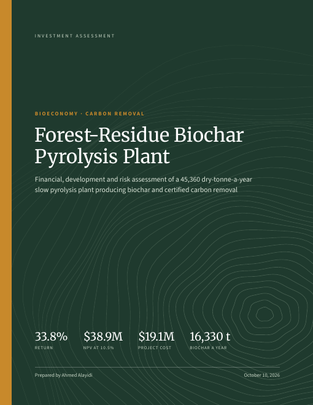
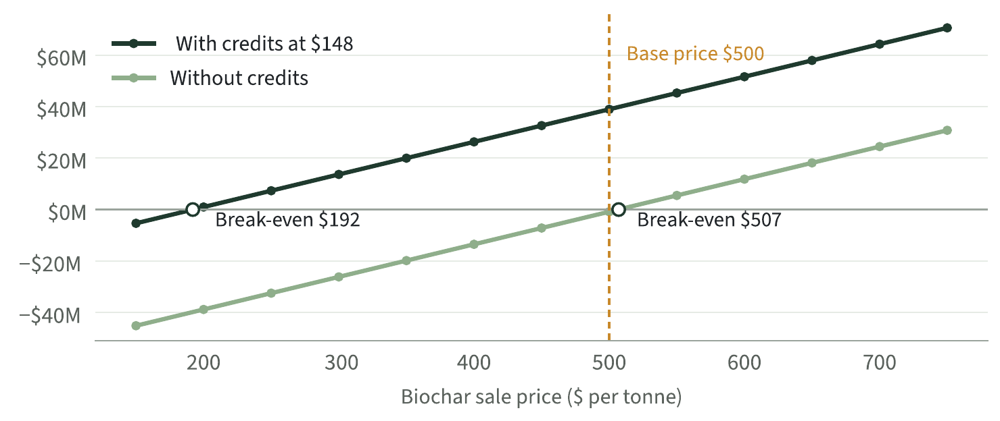
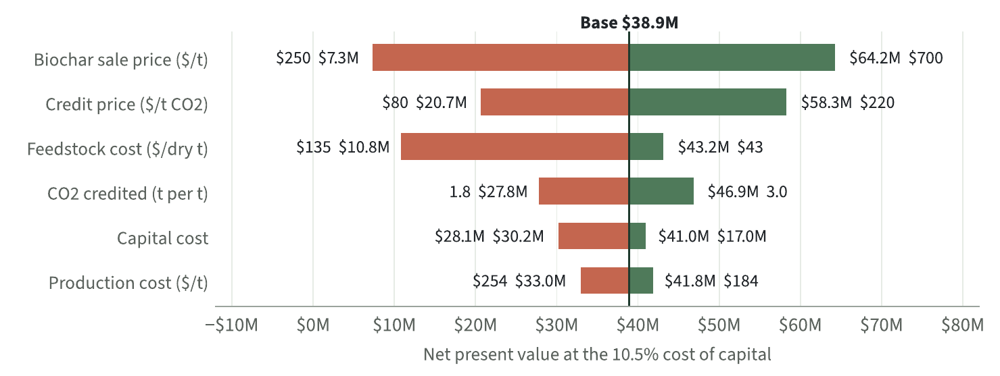
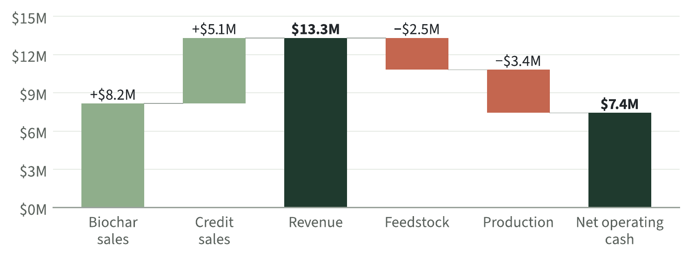

# Investment Assessment: Forest-Residue Biochar Pyrolysis Plant

A reproducible, bank-format investment assessment of a slow pyrolysis plant that turns 45,360 dry tonnes a year of forest residue into 16,330 tonnes of biochar and certified carbon removal. One Python model produces every number, figure and table in a 32-page PDF report.

<p align="center"></p>

**[Read the full report (PDF)](Investment_Assessment_Biochar_Pyrolysis_Plant.pdf)**

**[Open the live Investment Explorer](https://a-alay.github.io/biochar-investment-assessment/)**: move the biochar price, credit price, costs and financing and watch the return, value, payback and break-even update. It runs the same model in the browser and matches the Python results to the last digit shown.

## Headline results

| Measure | Value |
| --- | --- |
| Financial internal rate of return | 33.8% |
| Weighted average cost of capital (hurdle) | 10.5% |
| Net present value at 10.5% | $38.9 million |
| Project cost | $19.1 million |
| Simple payback | 3.1 years from start of operation |
| Biochar price below which value turns negative | $192 a tonne (with credits); $507 (without) |

The project clears its cost of capital under every standard adverse test. The biochar sale price is the input it depends on most.







## What the report contains

The structure follows the Asian Development Bank's published Report and Recommendation of the President and its financial analysis appendices. After the investment scenario (the givens every section rests on), the key figures and the executive summary, the report runs in three parts and three annexes:

- **Part I, Project and market:** investment overview, technology description with process flow, market context, development impact and monitoring framework
- **Part II, Costs and returns:** project cost and financing plan with weighted average cost of capital, operating economics, basis of the analysis, year-by-year cash flow, sensitivity tests with switching values, range tests, scenarios and break-even values
- **Part III, Risk and delivery:** risk assessment, implementation arrangements and timeline, safeguards, recommendation with five conditions
- **Annexes:** assumption register, model method and checks, sources

## Evidence base

Every model input is listed in [`model/inputs.csv`](model/inputs.csv) with its value, unit, status and exact source location (page, table or section).

- **Sourced:** plant size, yield, capital, feedstock cost, production cost, life, salvage and staffing come from one reference design (Worden, Oregon; thermal pyrolysis; heat recovery only) in Sessions et al. (2019), *Biomass and Bioenergy* 123: 175 to 185. The carbon credit price comes from S&P Global (October 2025).
- **Assumptions:** biochar sale price, CO2 credited per tonne, credit fees, start-up curve, and debt and equity terms.

The model reproduces two figures from the source study: full-capacity biochar output (16,329.6 t against 16,330 t) and production plus feedstock cost per tonne ($359.8 against $359).

## Repository layout

```
.
├── Investment_Assessment_Biochar_Pyrolysis_Plant.pdf   The final report (32 pages)
├── model/
│   ├── model.py        Cash flow, returns, sensitivity, scenarios, break-evens, checks
│   ├── inputs.csv      Every input, with status and exact source location
│   └── designs.csv     The 16 designs in the source study (capital and cost per tonne)
├── outputs/
│   ├── results.json    Full model results, every year of the cash flow
│   └── results.md      Readable results
├── report/
│   ├── charts.py       Builds the data charts from outputs/results.json
│   ├── diagrams.py     Builds the process flow, results chain, timeline and cover art
│   ├── build.py        Builds the report PDF from the model (HTML and CSS rendered by Chromium)
│   ├── style.css       Report design
│   └── fig/            Generated figures (SVG)
├── docs/
│   ├── index.html      The Investment Explorer (live dashboard, served by GitHub Pages)
│   ├── fonts/, d3.min.js, fonts.css   Files the dashboard loads
│   └── images/         PNG previews used in this README and the link preview
├── run_all.py          Runs the model, figures and report in one command
└── requirements.txt
```

## Reproduce

```bash
python -m venv .venv
.venv\Scripts\activate          # Windows; on macOS or Linux: source .venv/bin/activate
pip install -r requirements.txt
python -m playwright install chromium
python run_all.py
```

The run takes under a minute. It rewrites `outputs/` and `report/fig/`, and writes the report PDF to `report/rebuild/`. To test a different case, change a value in `model/inputs.csv` and run again.

The report is set in Source Sans 3 (text, tables and charts) and Merriweather (headings and key figures), both free from Google Fonts.

## Method in brief

1. Incremental cash flows against a without-project case; pre-tax, nominal, prices held flat.
2. Year 0 is construction; years 1 to 20 are operation, at 60%, 85%, then 100% of capacity.
3. Revenue is biochar sales plus carbon credit sales net of fees; operating cost is feedstock plus direct production cost; 20% salvage in year 20.
4. The project is viable when its financial internal rate of return exceeds the weighted average cost of capital.
5. Sensitivity follows the ADB format: plus or minus 10% tests, a one-year delay, and switching values found by root search.

## Sources

- Sessions, J. et al. (2019). Can biochar link forest restoration with commercial agriculture? *Biomass and Bioenergy* 123: 175 to 185. [PDF](https://extensionweb.forestry.oregonstate.edu/sites/default/files/BiocharForest-to-Farm2019.pdf)
- Carbon Credits (Dec. 3, 2025). [Biochar Carbon Credits in 2025: Stable Prices Amid Weakening Demand](https://carboncredits.com/?p=39628) (reporting S&P Global prices)
- CDR.fyi (Sep. 9, 2025). [Biochar carbon removal market snapshot 2025](https://www.cdr.fyi/blog/biochar-carbon-removal-market-snapshot-2025)
- Senken (Aug. 20, 2026). [Carbon removal prices 2026 to 2040](https://www.senken.io/reports/carbon-removal-prices-2026-2040)
- NREL (2025). [Process Feasibility Analysis of Waste Biomass Valorization to Biochar and Bio-Oil via Slow and Fast Pyrolysis](https://research-hub.nrel.gov/en/publications/process-feasibility-analysis-of-waste-biomass-valorization-to-bio/)
- Iowa State University Bioeconomy Institute. [Estimating profitability of two biochar production scenarios](https://www.biorenew.iastate.edu/research/thermochemical/biochar/productionscenarios)

Format benchmarks: Asian Development Bank, [Financial Analysis, Bihar Power System Improvement Project](https://www.adb.org/sites/default/files/linked-documents/41626-01-ind-fa.pdf); [Southern Thailand Waste-to-Energy Project RRP](https://ewsdata.rightsindevelopment.org/files/documents/01/ADB-49067-001.pdf); [GWTE Circular Economy Project RRP](https://www.adb.org/sites/default/files/project-documents/58132/58132-001-rrp-en.pdf).

## Author

Ahmed Alayidi, agricultural economist (circular bioeconomy, techno-economic assessment, policy assessment), University of Nebraska-Lincoln.

## License

Code is released under the MIT License (see [LICENSE](LICENSE)). The report text and figures are released under CC BY 4.0. Source documents cited above belong to their authors and are linked, not redistributed.
